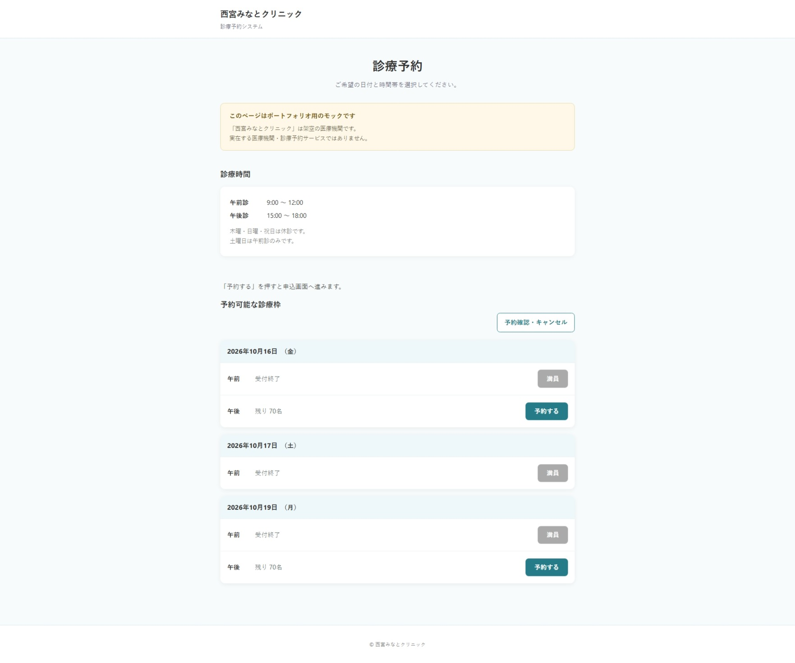
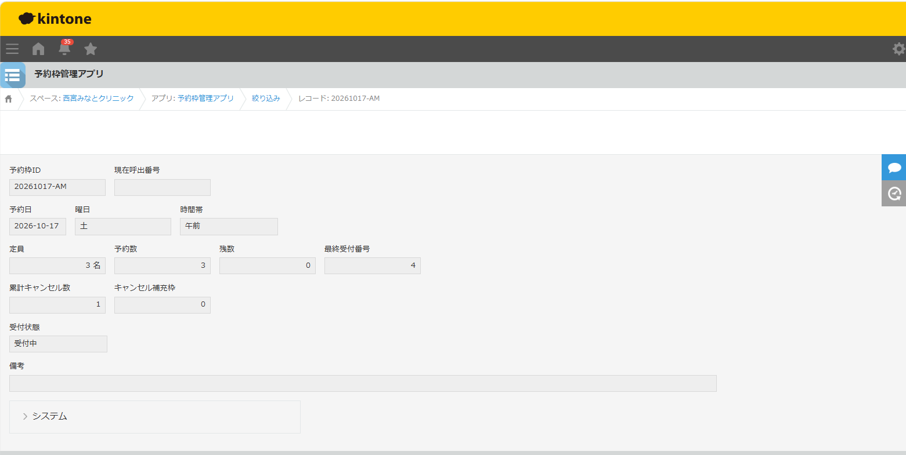
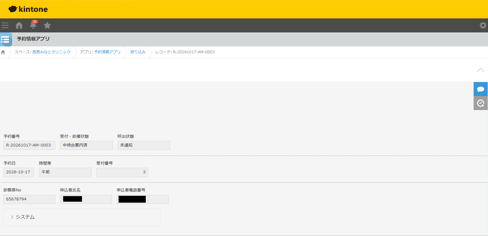
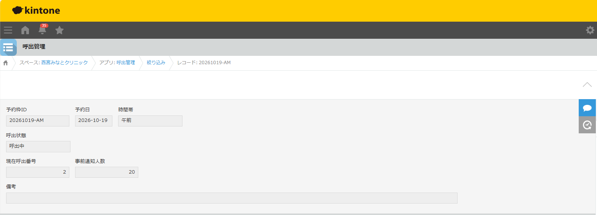

# 医療機関向け予約管理システム

## 1. システム概要

kintoneと外部Webサイトを連携させた、医療機関向けの診療予約管理システムです。

予約枠の自動生成、Web予約受付、キャンセルと再予約、来院受付、中待合への案内までを一元管理します。

フロントエンドにはHTML・CSS・JavaScript、サーバーサイドにはPHP、データ管理基盤にはkintoneを使用しています。

※本システムはポートフォリオ用のデモです。実在する医療機関の予約サービスではありません。

## 2. システム構成

### kintoneアプリ

| アプリ | 主な役割 |
|---|---|
| 予約枠生成アプリ | 対象年月の診療枠を生成 |
| 予約枠管理アプリ | 定員・予約数・残数・キャンセル数を管理 |
| 予約情報アプリ | 予約者情報・予約番号・受付状況を管理 |
| 呼出管理 | 現在呼出番号・事前通知人数を管理 |

### 外部Webサイト

- 予約可能な診療枠の一覧表示
- 予約申込
- 予約確認・キャンセル

## 3. システム連携

### 基本構成

```text
[利用者]
    |
    v
[予約Webサイト]
 HTML / CSS / JavaScript
    |
    v
[PHP API]
    |
    | kintone REST API
    v
[kintone]
    |-- 予約枠生成アプリ
    |-- 予約枠管理アプリ
    |-- 予約情報アプリ
    |-- 呼出管理
```

### 院内受付・案内フロー

```text
Web予約
   |
   v
予約済
   |
   | 来院受付ボタン
   v
来院済
   |
   | 中待合へ案内ボタン
   v
中待合案内済
   |
   | Bulk Request API
   v
呼出管理の現在呼出番号を更新
   |
   v
SMS通知候補者を抽出
   |
   v
[外部SMS送信サービス]
※未接続・実送信なし
```

## 4. 主な機能

### 4.1 予約枠生成・管理

- 対象年月に応じた予約枠の生成
- 休診日を考慮した診療枠管理
- 午前・午後の時間帯別管理
- 予約数・残数・キャンセル数の管理

#### デモ用診療条件

| 曜日 | 診療時間帯 |
|---|---|
| 月・火・水・金 | 午前・午後 |
| 木・日・祝日 | 休診 |
| 土 | 午前のみ |

通常の予約枠は午前70名、午後70名です。

### 4.2 Web予約受付

- PHP経由でkintoneの予約枠情報を取得
- 予約可能な診療枠を画面に表示
- 申込情報をkintoneに登録
- 予約番号と受付番号を自動採番
- 予約枠の残数を更新

### 4.3 キャンセル・再予約管理

- 予約キャンセル時に予約状態を更新
- 予約数・残数・累計キャンセル数を更新
- キャンセル補充枠を管理
- キャンセル済みの受付番号を再利用しない
- 再予約時に新しい受付番号を採番

#### 動作確認例

定員3名の予約枠で、以下の処理を検証しました。

| 項目 | 満枠時 | キャンセル後 | 再予約後 |
|---|---:|---:|---:|
| 予約数 | 3 | 2 | 3 |
| 残数 | 0 | 1 | 0 |
| 最終受付番号 | 3 | 3 | 4 |
| 累計キャンセル数 | 0 | 1 | 1 |
| キャンセル補充枠 | 0 | 1 | 0 |

基本的な予約・キャンセル・再予約の一連の動作を確認しています。

### 4.4 来院受付・中待合案内

kintoneの予約情報アプリにJavaScriptで操作ボタンを配置しています。

- 予約済の場合のみ「来院受付」ボタンを表示
- ボタン操作で「来院済」に変更
- 来院済の場合のみ「中待合へ案内」ボタンを表示
- 案内操作後は「中待合案内済」に変更
- 処理完了後は操作ボタンを非表示
- revisionを利用して更新競合を検知

### 4.5 呼出管理との連携

中待合案内処理では、kintone Bulk Request APIを使用します。

- 予約情報アプリのステータス更新
- 呼出管理アプリの現在呼出番号更新
- 現在呼出番号が後退しないよう制御
- 受付番号の欠番にも対応できる構成

複数アプリの更新をまとめて処理することで、データの整合性に配慮しています。

### 4.6 SMS通知候補者の抽出

現在呼出番号と事前通知人数を使い、通知対象となる予約者を抽出します。

主な抽出条件は以下のとおりです。

- 同一予約枠ID
- 受付・診療状態が「予約済」
- 呼出状態が「未通知」
- 現在呼出番号より後の受付番号
- 事前通知範囲内の受付番号

テストでは、現在呼出番号を0から1に更新した際に、受付番号2番・3番の通知候補が抽出されることを確認しました。

**SMS送信サービスとの接続および実際のSMS送信は未実装です。**

また、公開用JavaScriptでは、氏名・電話番号をConsoleに出力するデバッグ処理を削除しています。

## 5. 使用技術

| 技術 | 用途 |
|---|---|
| kintone | 予約情報・受付状況の管理 |
| JavaScript | Web画面制御・kintoneカスタマイズ |
| HTML / CSS | 予約サイトの画面構築 |
| PHP | サーバーサイドAPI |
| kintone REST API | レコード取得・登録・更新 |
| Bulk Request API | 複数レコードの一括更新 |
| GitHub | ソースコード・技術資料の管理 |

## 6. 設計上のポイント

### 外部Webサイトとkintoneの役割分離

利用者向け予約画面と医療機関側の管理画面を分離しています。

### APIを利用したデータ連携

PHPを経由してkintone REST APIを利用する構成としています。

### キャンセル後の再予約

キャンセルによる空き枠を再利用しながら、受付番号の履歴を維持します。

### 受付・診療状態と呼出状態の分離

院内での案内状況と外部通知の状況を別々に管理しています。

### データ更新時の整合性

revisionによる更新競合の検知と、Bulk Request APIによる複数アプリ更新を採用しています。

## 7. 開発・テスト状況

| 機能 | 状況 |
|---|---|
| kintoneアプリ構成 | 作成済み |
| 予約枠生成・管理 | 基本動作確認済み |
| Web予約受付 | 基本動作確認済み |
| 予約キャンセル | 基本動作確認済み |
| キャンセル枠への再予約 | 基本動作確認済み |
| 来院受付 | 動作確認済み |
| 中待合案内 | 動作確認済み |
| 呼出番号の更新 | 動作確認済み |
| SMS通知候補の抽出 | 動作確認済み |
| SMS実送信 | 未実装 |
| 同時操作・通信障害時の検証 | 未完了 |
| 操作マニュアル | 作成予定 |

## 8. 画面キャプチャ

### Web予約枠一覧

診療日・時間帯ごとの予約枠と、残り予約可能人数を表示します。



### 予約枠管理

予約数、残数、最終受付番号、キャンセル数、補充枠を管理します。



### 予約情報・ステータス管理

予約番号・受付番号と、来院受付から中待合案内までの状態を管理します。



### 呼出管理

現在呼出番号および事前通知人数を管理します。



## 9. 今後の予定

- アプリ構成・フィールド設計資料の公開
- API連携仕様書の整備
- 操作マニュアルの作成
- 公開可能なソースコードの整理
- 外部SMS送信サービスとの連携検討

## 10. セキュリティ・注意事項

本システムは学習・技術検証用のデモシステムです。

実在する患者情報や医療機関の機密情報は使用しません。

APIトークン、認証情報、サーバー固有の設定値などは公開対象から除外します。

同時予約や通信障害時を含むすべての運用条件について、検証が完了しているわけではありません。

本システムは実際の医療業務での利用を保証するものではありません。
