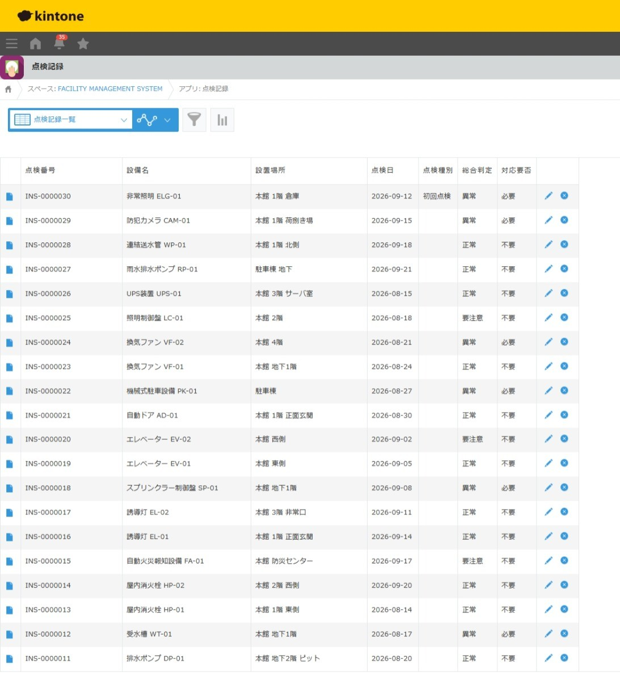
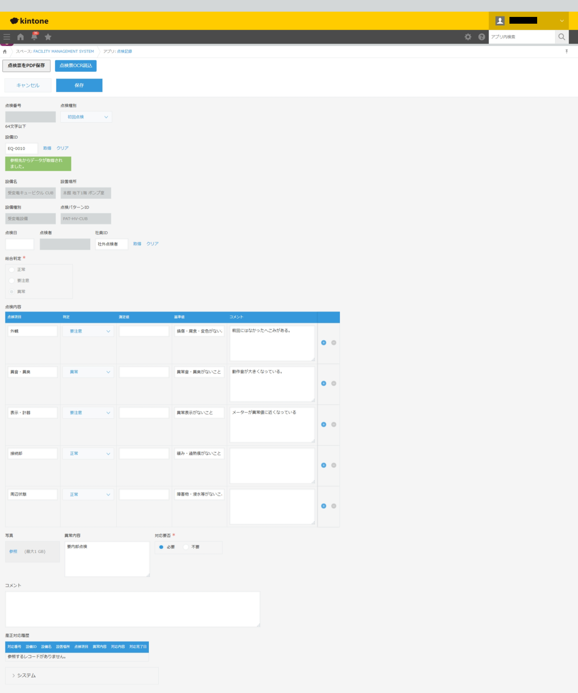

# 設備点検管理システム

## 1. システム概要

設備の点検記録から不具合の把握、是正対応の管理までを一元化することを目的とした、kintoneベースの業務管理システムです。

点検業務に必要なマスタ情報と点検・是正対応の記録を管理し、情報の追跡性と業務の効率化を目指しています。

※本システムは技術検証・ポートフォリオ用のデモです。

## 2. システム構成

### 主な管理対象

- 設備情報
- 点検記録
- 是正対応記録
- 各種マスタ情報

## 3. 主な機能

### 点検記録管理

- 設備ごとの点検結果の登録・管理
- 点検履歴の蓄積と参照

### 是正対応管理

- 点検で確認された不具合に対する是正対応の記録
- 対応状況の管理

### マスタ管理

- 設備・点検業務に必要な基礎情報の管理
- マスタ情報を利用した入力業務の効率化

### JavaScriptカスタマイズ

- 入力支援処理
- 管理番号の自動採番
- サブテーブルの判定結果に基づく総合判定の自動算出
- 総合判定に応じた異常内容・対応要否フィールドの入力制御
- 点検番号の自動採番

## 4. 使用技術

| 技術 | 用途 |
|---|---|
| kintone | データ管理・業務アプリ構築 |
| JavaScript | 入力支援・採番処理 |
| kintone JavaScript API | 画面イベントに応じた処理 |

## 5. 想定業務フロー

1. 設備および必要なマスタ情報を登録する
2. 設備の点検結果を記録する
3. 不具合が確認された場合は是正対応を登録する
4. 対応状況と点検履歴を確認する

## 6. 設計上のポイント

- 点検記録と是正対応を区別し、業務の流れを把握しやすくする
- マスタ情報を活用して入力内容の統一を図る
- JavaScriptによる入力支援で手作業を削減する
- 点検履歴を継続的に参照できる構成を目指す

## 7. 今後の公開予定

- アプリ構成・フィールド設計資料
- 操作マニュアル
- 画面キャプチャ
- JavaScriptソースコード（公開可能な範囲）

## 8. 注意事項

本システムは学習・技術検証用に制作したデモシステムです。

実際の企業・設備に関する機密情報は掲載していません。

 ## 画面キャプチャ

### 点検記録一覧

### 点検記録入力画面

設備マスタから設備情報を取得し、点検パターンに応じた
点検項目を展開します。

