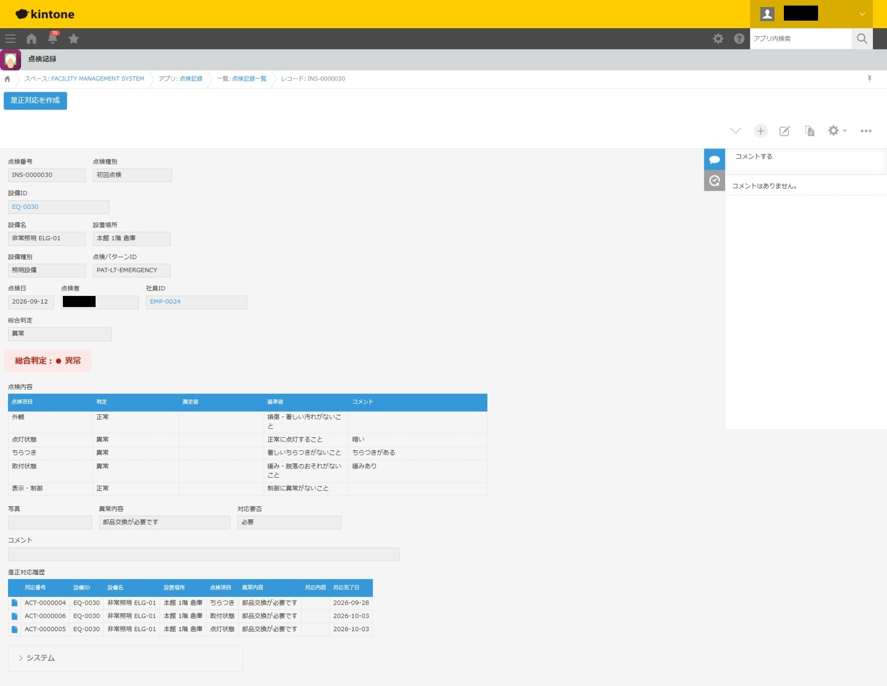

# 設備点検管理システム

## 1. システム概要

設備の点検記録から不具合の把握、是正対応の管理までを一元化することを目的とした、kintoneベースの業務管理システムです。

点検業務に必要なマスタ情報と点検・是正対応の記録を管理し、情報の追跡性と業務の効率化を目指しています。

※本システムは技術検証・ポートフォリオ用のデモです。

## 2. システム構成

### 主な管理対象

- 設備情報
- 点検記録
- 是正対応記録
- 各種マスタ情報

## 3. 主な機能

### 点検記録管理

- 設備ごとの点検結果の登録・管理
- 点検履歴の蓄積と参照

### 是正対応管理

- 点検で確認された不具合に対する是正対応の記録
- 対応状況の管理

### マスタ管理

- 設備・点検業務に必要な基礎情報の管理
- マスタ情報を利用した入力業務の効率化

**JavaScriptカスタマイズ**

- 入力支援処理
- 管理番号の自動採番
- サブテーブルの判定結果に基づく総合判定の自動算出
  - 異常が1件でもあれば「異常」
  - 異常がなく、要注意が1件でもあれば「要注意」
  - それ以外は「正常」
- 総合判定に応じた異常内容・対応要否フィールドの入力制御
  - 総合判定の視覚的表示
  - 点検結果に応じて「正常」「要注意」「異常」を色分けして表示し、判定状況を把握しやすくする
- 点検項目の自動展開
- **手書き点検記録のOCR取込**
  - 手書きの点検記録をOCRで読み取り、文字情報を取得
  - 認識結果をkintoneの対応するフィールドに反映し、転記作業を支援

## 4. 使用技術

| 技術 | 用途 |
|---|---|
| kintone | データ管理・業務アプリ構築 |
| JavaScript | 入力支援・採番処理 |
| kintone JavaScript API | 画面イベントに応じた処理 |

## 5. 想定業務フロー

1. **設備情報の取得**  
   点検担当者が設備IDを指定し、設備マスタから設備名・設置場所・点検パターンなどを取得する。

2. **点検項目の展開**  
   取得した点検パターンに基づき、必要な点検項目をサブテーブルに展開する。

3. **点検結果の入力**  
   担当者が各点検項目の判定結果・測定値・コメントを入力する。

4. **総合判定の自動算出**  
   JavaScriptで各項目の判定結果を集約し、「異常」「要注意」「正常」の総合判定を自動算出する。

5. **異常内容・対応要否の入力**  
   総合判定が「異常」または「要注意」の場合、必要に応じて異常内容や対応要否を入力する。

6. **点検記録の保存・確認**  
   点検記録を保存し、点検記録一覧から履歴を確認する。

## 6. 設計上のポイント

- 点検記録と是正対応を区別し、業務の流れを把握しやすくする
- マスタ情報を活用して入力内容の統一を図る
- JavaScriptによる入力支援で手作業を削減する
- 点検履歴を継続的に参照できる構成を目指す

## 7. 今後の公開予定

- アプリ構成・フィールド設計資料
- 操作マニュアル
- JavaScriptソースコード（公開可能な範囲）

## 8. 注意事項

本システムは学習・技術検証用に制作したデモシステムです。

実際の企業・設備に関する機密情報は掲載していません。

 ## 画面キャプチャ

### 点検記録一覧

### 点検記録入力画面

設備マスタから設備情報を取得し、点検パターンに応じた
点検項目を展開します。

### 点検結果・総合判定画面

各点検項目の判定結果から総合判定を自動算出し、正常・要注意・異常を色分けして表示します。

総合判定は手動変更できないよう制御しています。また、異常内容や対応要否に加え、関連する是正対応履歴を確認できます。

